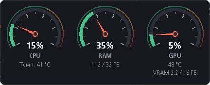
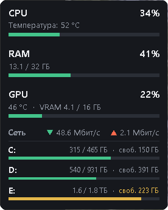
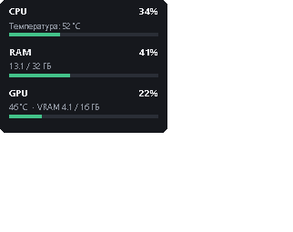
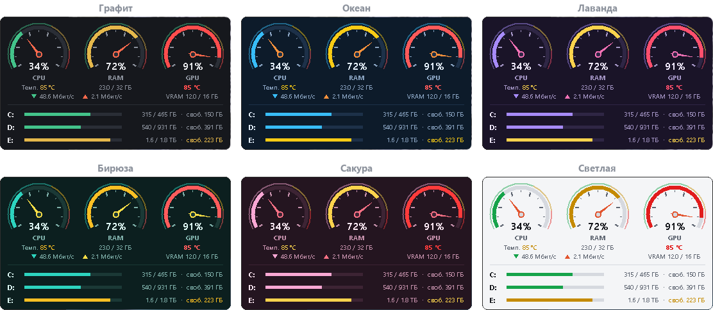
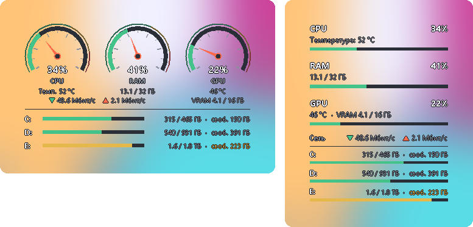

# SysMon Widget: загрузка CPU, RAM и GPU на рабочем столе

Маленький виджет для Windows 10/11. Показывает загрузку процессора, оперативной памяти и видеокарты в реальном времени, а также температуру, занятую память, скорость интернета и место на дисках. Почти не нагружает систему.

<p align="center">
  <br>
  <sub>Вид «Спидометры» (на анимации демо-значения)</sub>
</p>

<p align="center">
  
  &nbsp;&nbsp;
  <br>
  <sub>Вид «Полоски» · изменение размера за угол</sub>
</p>

<p align="center">
  <br>
  <sub>6 цветовых тем. Температура 85 °C: у CPU (предел 95 °C) жёлтая, у GPU (предел 87 °C) красная</sub>
</p>

<p align="center">
  <br>
  <sub>Прозрачный фон: видны только цифры и шкалы, текст с обводкой читается на любых обоях</sub>
</p>

## Возможности

- **Три показателя:** CPU, RAM, GPU. Для каждого: процент загрузки, полоса или стрелка, цвет по нагрузке (зелёный до 60%, жёлтый до 85%, красный выше)
- **Подробности:** температура CPU и GPU, занятая и общая память (`13.1 / 32 ГБ`), видеопамять
- **Скорость интернета:** загрузка ▼ и выгрузка ▲ в Мбит/с (как у провайдера) или МБ/с (как при скачивании). Учитываются только реальные сетевые адаптеры, виртуальные (Hyper-V, WSL, VMware, VirtualBox) пропускаются
- **Диски:** каждый локальный диск отдельной строкой: буква, полоса занятости, `занято / объём` и свободное место. Полоса становится жёлтой при заполнении от 85% и красной от 95%. Высота окна подстраивается под количество дисков, а если окно из-за этого вылезает за край экрана, оно само сдвигается
- **Предупреждение о перегреве:** температура подсвечивается **жёлтым**, когда до предела компонента остаётся 12 °C или меньше, и **красным жирным**, когда остаётся 4 °C или меньше. Предел определяется для конкретного железа (см. ниже)
- **Два вида:** «Полоски» (компактно) и «Спидометры» (шкалы со стрелками, как в автомобиле)
- **Свой набор показателей:** любой из них (CPU, RAM, GPU, сеть, диски) можно выключить галочкой в меню, окно подстроится
- **6 цветовых тем:** Графит, Океан, Лаванда, Бирюза, Сакура, Светлая
- **Прозрачный фон:** панель исчезает, остаются только цифры, шкалы и полосы. У текста тонкая обводка, чтобы он читался на любых обоях
- **Окно:** без рамки, полупрозрачное, со скруглёнными углами. Можно держать поверх всех окон
- **Мышь:** окно перетаскивается, а за любой угол меняется размер. Текст и шкалы масштабируются
- **Память настроек:** позиция, размер, вид, тема, фон и прозрачность сохраняются между запусками
- **Обновление** раз в секунду
- **Устойчивость:** если какой-то показатель недоступен, виджет пишет «н/д» и продолжает работать
- **Лёгкость:** от 0,2% до 1,5% одного ядра (зависит от вида) и около 65 МБ памяти

### Пределы температуры

| Компонент | Откуда берётся предел | Пример |
|---|---|---|
| Видеокарта NVIDIA | драйвер (максимальная рабочая температура из NVML) | RTX 5060 Ti: 87 °C → жёлтый с 75 °C, красный с 83 °C |
| Процессор AMD | Tjmax по модели: Ryzen 95 °C, Ryzen X3D 89 °C | Ryzen 5 3500: жёлтый с 83 °C, красный с 91 °C |
| Процессор Intel | точный Tjmax из LibreHardwareMonitor («Distance to TjMax»), иначе 100 °C | |
| Видеокарты AMD/Intel | 90 °C | |

### Поддержка видеокарт

| Видеокарта | Способ чтения | Что видно |
|---|---|---|
| NVIDIA | официальная библиотека NVML (через драйвер) | загрузка, видеопамять, температура |
| AMD, Intel (и любые другие) | счётчики производительности Windows (как в Диспетчере задач) | загрузка, видеопамять |

Нужный способ выбирается автоматически.

---

## Быстрый старт (без программирования)

1. Откройте вкладку **[Releases](../../releases)** справа на странице и скачайте `SysMonWidget.exe`.
2. Положите файл в любую папку и запустите двойным кликом.
3. Если появится синее окно «Windows защитила ваш компьютер», нажмите **«Подробнее» → «Выполнить в любом случае»**. Так Windows реагирует на любые программы без платной цифровой подписи.

### Управление

| Действие | Результат |
|---|---|
| Зажать левую кнопку и тянуть | Переместить виджет |
| Навести на любой угол и тянуть | Изменить размер (60–300%) |
| Правый клик → **Всегда поверх окон** | Включить или выключить |
| Правый клик → **Вид** | «Полоски» или «Спидометры» |
| Правый клик → **Прозрачность** | 100% … 40% |
| Правый клик → **Цвет** | Одна из 6 тем |
| Правый клик → **Прозрачный фон** | Убрать или вернуть фон-панель |
| Правый клик → **Скорость сети в** | Мбит/с или МБ/с |
| Правый клик → **Показатели** | Галочками включить или выключить CPU, RAM, GPU, скорость интернета и диски. Окно подстраивается под выбранное; последнюю галочку снять нельзя |
| Правый клик → **Сбросить размер** | Вернуть 100% |

> **На прозрачном фоне** окно реагирует на мышь только там, где что-то нарисовано: на цифрах, шкалах и полосах. Через пустые места клики проходят к окнам позади.
> Перетаскивайте виджет за цифры или шкалы, а размер меняйте за треугольный уголок справа внизу.
> Уголок появляется, только когда курсор находится над виджетом.
| Правый клик → **Закрыть** | Закрыть виджет |

Настройки хранятся в `%APPDATA%\SysMonWidget\settings.json`. Если удалить этот файл, настройки сбросятся.

### Автозагрузка вместе с Windows

**Самый простой способ:**
1. Нажмите `Win + R`, введите `shell:startup` и нажмите Enter. Откроется папка «Автозагрузка».
2. Перетащите туда `SysMonWidget.exe`, удерживая клавишу **Alt**. Так создастся ярлык.

**Если вы собирали программу из исходников**, запустите `add_to_autostart.bat`. Убрать виджет из автозагрузки можно через `remove_from_autostart.bat`.

---

## Запуск из исходников

Нужен Python 3.10 или новее.

```powershell
# 1. Установить Python (если его нет)
winget install -e --id Python.Python.3.12

# 2. Скачать проект
git clone https://github.com/RAINSTYLE/sysmon-widget.git
cd sysmon-widget
```

Дальше всё делается двойным кликом по файлам в папке проекта:

| Файл | Что делает |
|---|---|
| `install.bat` | Создаёт окружение `.venv` и ставит библиотеки из `requirements.txt` |
| `run.bat` | Запускает виджет |
| `build_exe.bat` | Собирает один файл `dist\SysMonWidget.exe` |
| `add_to_autostart.bat` | Добавляет `dist\SysMonWidget.exe` в автозагрузку |
| `remove_from_autostart.bat` | Убирает виджет из автозагрузки |

Установить библиотеки можно и вручную:

```powershell
python -m venv .venv
.venv\Scripts\python.exe -m pip install -r requirements.txt
.venv\Scripts\pythonw.exe widget.py
```

**Самопроверка:** покажет, какие данные удаётся прочитать на вашем компьютере.

```powershell
.venv\Scripts\python.exe widget.py --selftest
```

---

## Температура процессора

Windows не даёт обычным программам читать температуру процессора, поэтому по умолчанию там стоит «н/д». Чтобы она появилась, используйте бесплатную программу **[LibreHardwareMonitor](https://github.com/LibreHardwareMonitor/LibreHardwareMonitor/releases)**:

1. Запустите LibreHardwareMonitor от имени администратора.
2. Включите **Options → Remote Web Server → Run** (порт 8085 по умолчанию).
3. Через пару секунд температура появится в виджете.

Чтобы это работало постоянно, включите там же «Start Minimized», «Minimize To Tray» и «Run On Windows Startup».

---

## Как это устроено

- **Язык:** Python, интерфейс на `tkinter` (входит в Python)
- **CPU, RAM, сеть и диски:** библиотека [`psutil`](https://github.com/giampaolo/psutil)
- **GPU NVIDIA:** [`nvidia-ml-py`](https://pypi.org/project/nvidia-ml-py/) (NVML)
- **GPU AMD/Intel:** счётчики Windows PDH (`GPU Engine`, `GPU Adapter Memory`)
- **Температура CPU:** JSON от веб-сервера LibreHardwareMonitor
- **Сборка `.exe`:** [PyInstaller](https://pyinstaller.org)

Чтобы окно не подвисало, данные собираются в отдельном фоновом потоке. Неподвижные элементы рисуются один раз, при анимации перерисовываются только стрелки и цифры.

```
widget.py                 код виджета
requirements.txt          зависимости
*.bat                     установка, запуск, сборка, автозагрузка
docs/                     картинки для README
tools/make_media.py       генерация картинок и GIF для README
```

## Другие ОС

Виджет рассчитан на Windows. Чтобы он работал на Linux или macOS, нужно заменить вызовы Windows API: DPI, скруглённые углы, счётчики PDH, защиту от повторного запуска и автозагрузку.

## Лицензия

[MIT](LICENSE). Код можно свободно использовать, изменять и распространять, в том числе в коммерческих проектах. Единственное условие: сохранять текст лицензии и упоминание автора.
